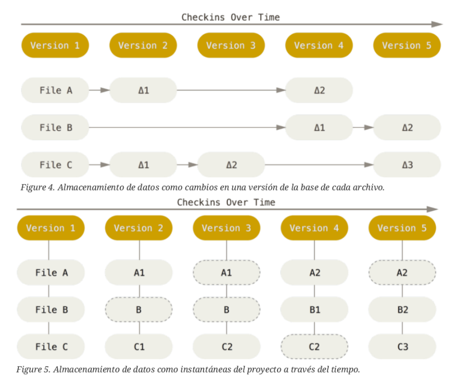
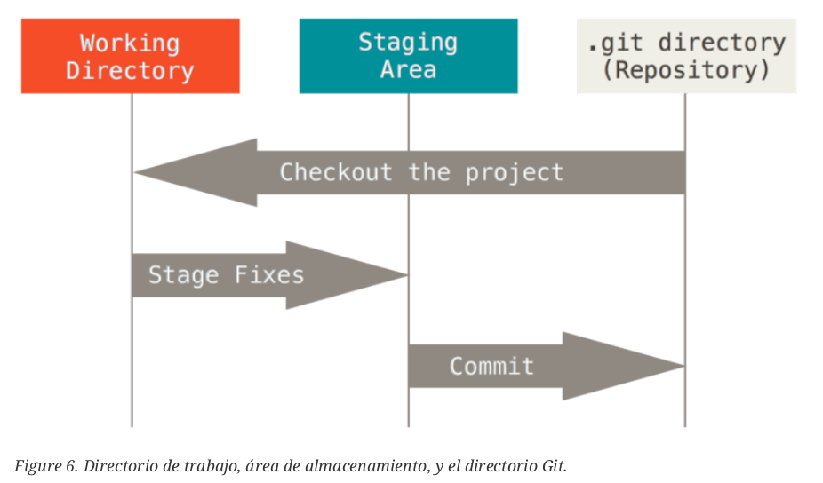

# Notas do libro *Pro Git* de Scott Chacon e Ben Straub
## Primeiro tema do libro *Pro Git*: "Inicio - Sobre o Control de Versións"
### 1. Evolución dos Sistemas de Control de Versións (VCS)
Un VCS rexistra os cambios nos ficheiros ao longo do tempo para poder recuperar versións anteriores. Hai tres tipos:
*   **Locais:** gardábanse copias noutros directorios ou bases de datos sinxelas (como RCS). Son propensos a erros.
*   **Centralizados (CVCS):** un único servidor contén todos os ficheiros e os clientes descargan as versións (como CVS ou Subversion). *Vantaxe:* todos saben que fai o resto. *Desvantaxe:* o servidor é un **punto único de fallo**.
*   **Distribuídos (DVCS):** cada cliente ten unha **copia completa** do repositorio (como Git). Se o servidor falla, calquera cliente pode restauralo.

### 2. Breve historia de Git
Git naceu en 2005, creado por Linus Torvalds (creador de Linux) despois de que a comunidade de Linux deixase de usar o sistema propietario BitKeeper. Os seus obxectivos eran: **velocidade, deseño sinxelo, soporte para miles de ramas (desenvolvemento non lineal), completamente distribuído** e capaz de xestionar grandes proxectos.

### 3. Fundamentos de Git (como funciona)
*   **Instantáneas (snapshots), non diferenzas:** a diferenza doutros sistemas que gardan os cambios (deltas) ficheiro por ficheiro, Git fai unha “foto” do estado de todos os ficheiros en cada confirmación. Se un ficheiro non cambiou, fai unha ligazón ao anterior para aforrar espazo.


*   **Operacións locais:** case todas as accións (ver historial, facer commits) fanse en local, de xeito instantáneo e sen necesidade de conexión a internet.
*   **Integridade (SHA-1):** todo se verifica mediante unha suma de comprobación (hash SHA-1). É imposible cambiar un ficheiro sen que Git o detecte.
*   **Só engade información:** é moi difícil facer que Git borre datos de xeito accidental unha vez confirmados.

### 4. Os 3 estados (moi importante)
Os ficheiros en Git poden estar en tres estados:
1.  **Confirmado (Committed):** os datos están gardados de xeito seguro no directorio de Git (base de datos local).
2.  **Modificado (Modified):** cambiaches o ficheiro pero non o confirmaches.
3.  **Preparado (Staged):** marcaches o ficheiro modificado para que forme parte da próxima confirmación.


Isto corresponde a 3 áreas do proxecto: **Directorio de traballo** (onde editas), **Área de preparación** (staging area, onde pos o que queres gardar) e **Directorio de Git** (onde se garda o historial).

- O **directorio de traballo** é unha copia dunha versión do proxecto. Estes arquivos sácanse da base de datos comprimida no directorio de Git, e colócanse en disco para que os poidas usar ou modificar.
- A **área de preparación** é un arquivo, xeralmente contido no teu directorio de Git, que almacena información acerca do que vai ir na túa próxima confirmación. A veces chámaselle **índice (*index*)**.
- O **directorio de Git** é onde se almacenan os metadatos e a base de datos de obxectos para o teu proxecto. É a parte máis importante de Git, e é o que se copia cando clonas un repositorio desde outra computadora.

**Fluxo de traballo básico:** Modificar ficheiros -> Preparalos (`Stage`) -> Confirmalos (`Commit`).

### 5. Instalación e Configuración
*   **Liña de comandos:** é a única maneira de executar *todos* os comandos de Git.
*   **Configuración inicial:** cómpre facelo unha soa vez.
    *   Identidade: `git config --global user.name "Nome"` e `git config --global user.email "correo@exemplo.gal"`.
    *   Editor por defecto: `git config --global core.editor vim` (ou o que prefiras).
*   Se queres comprobar a tu configuración, podes usar o comando `git config --list` para amosar tódalas propiedades que Git configurou:
```bash
$ git config --list
user.name=Ricardo Veiga
user.email=ricardo@exemplo.gal
color.status=auto
color.branch=auto
color.interactive=auto
color.diff=auto
...
```
*   **Axuda:** podes consultar o manual de calquera comando con `git help <comando>` ou `git <comando> --help`.

## Segundo tema do libro *Pro Git*: "Fundamentos de Git"

### 1. Obter un repositorio de Git
Hai dúas formas de comezar:
*   **Inicializar un directorio existente:** usa `git init`. Isto crea o subdirectorio `.git` (o esqueleto do repositorio). Despois podes engadir ficheiros co comando `git add` e facer a primeira confirmación (`git commit`).
*   **Clonar un repositorio existente:** usa `git clone [url]`. A diferenza doutros sistemas (que fan un *checkout*), Git descarga unha copia completa de todos os datos e versións do servidor.

### 2. Ciclo de vida dos ficheiros
Os ficheiros no teu directorio de traballo poden ser:
*   **Rastrexados (Tracked):** estaban na última instantánea. Poden estar *sen modificar*, *modificados* ou *preparados* (staged).
*   **Non rastrexados (Untracked):** todo o demais. Git non os inclúe nos commits a menos que llo indiques.

**Fluxo básico:** modificar ficheiros-> `git add` (preparar) -> `git commit` (confirmar).

### 3. Comandos esenciais para gardar cambios
*   **`git status`:** amosa o estado dos ficheiros (podes usar `git status -s` para unha versión curta).
*   **`git add <ficheiro>`:** comeza a rastrexar ficheiros novos ou prepara os modificados para a próxima confirmación.
*   **`.gitignore`:** ficheiro onde especificas patróns (*glob*) para que Git ignore certos ficheiros (p.e.: ficheiros temporais, compilados, etc.).
*   **`git diff`:** amosa os cambios exactos que fixeches pero que **aínda non preparaches**.
*   **`git diff --staged`:** amosa os cambios que xa **preparaches** e que van no próximo *commit*.
*   **`git commit`:** garda a instantánea do que está preparado. Podes usar `-m "mensaxe"` para escribir a mensaxe directamente ou `-a` para preparar automaticamente todos os ficheiros rastrexados e confirmar.
*   **`git rm`:** elimina ficheiros do seguimento e do disco. Se queres mantelo no disco pero que Git o ignore, usa `git rm --cached`.
*   **`git mv`:** renomea ficheiros (é equivalente a usar `mv`, `git rm` e `git add`).

### 4. Ver o historial
O comando **`git log`** amosa o historial de confirmacións en orde cronolóxica inversa. Podes personalizalo moito con opcións como:
*   `-p`: amosa as diferenzas (parches) de cada commit.
*   `--stat`: amosa estatísticas de liñas engadidas/eliminadas.
*   `--pretty=oneline` ou `--pretty=format:"..."`: cambia o formato de saída.
*   `--graph`: engade un gráfico ASCII das pólas.
*   Filtros como `--since`, `--until`, `--author`, `--grep` ou buscar por código cunha cadea con `-S`.

### 5. Desfacer cousas
*   **Desfacer un commit recente:** `git commit --amend` (permite engadir ficheiros olvidados ou cambiar a mensaxe).
*   **Quitar un ficheiro do *stage* (despreparar):** `git reset HEAD <ficheiro>`.
*   **Descartar cambios nun ficheiro (perigoso):** `git checkout -- <ficheiro>`. Sobrescribe o ficheiro coa última versión confirmada. *Atención: os cambios non confirmados pódense perder para sempre.*

### 6. Traballar con repositorios remotos
*   **`git remote`:** lista os repositorios remotos (xeralmente o principal chámase `origin`). Usa `-v` para ver as URLs.
*   **`git remote add <nome> <url>`:** engade un novo remoto.
*   **`git fetch <remoto>`:** descarga os datos do remoto pero **non** os combina co teu traballo.
*   **`git pull`:** descarga os datos e **combínaos** automaticamente coa túa póla actual.
*   **`git push <remoto> <rama>`:** envía os teus *commits* ao servidor remoto.
*   **`git remote show <remoto>`:** dá información detallada sobre o estado do remoto.
*   **`git remote rename` / `git remote rm`:** renomea ou elimina un remoto.

### 7. Etiquetado (*tags*)
Serve para marcar puntos importantes no historial (p.e.: versións).
*   **Lixeiras:**un simple punteiro a un commit (`git tag v1.0`).
*   **Anotadas:** gárdanse como obxectos completos, con autor, data e mensaxe (`git tag -a v1.0 -m "versión 1.0"`).
*   Para enviar as etiquetas ao servidor, cómpre facelo explicitamente: `git push origin <etiqueta>` ou `git push origin --tags`.

### 8. Alias (atallos)
Podes crear atallos para comandos longos usando `git config --global alias.<nome> <comando>`. Por exemplo: `git config --global alias.co checkout` fai que `git co` actúe como `git checkout`.


## Terceiro tema do libro *Pro Git*: "Ramificacións en Git"
